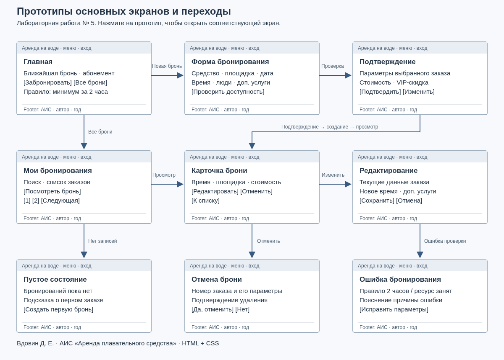
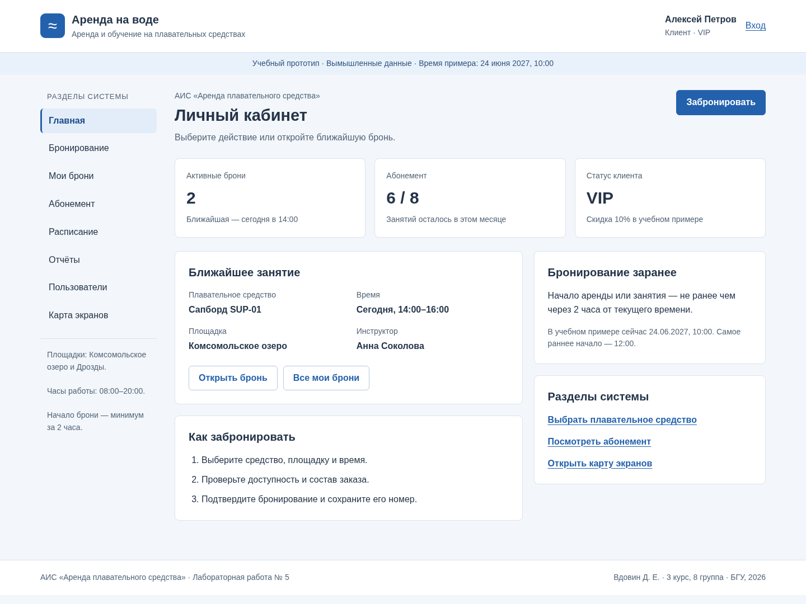
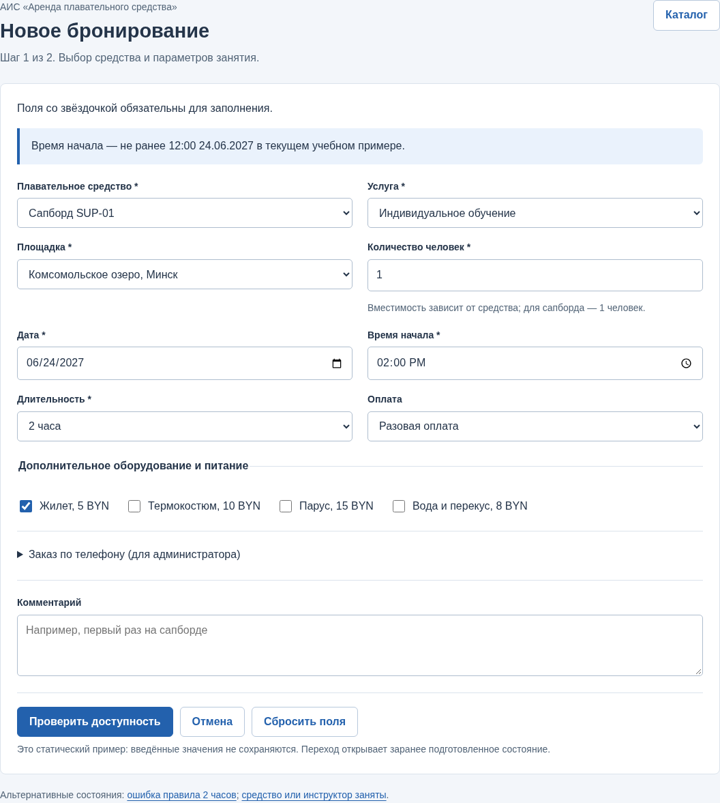
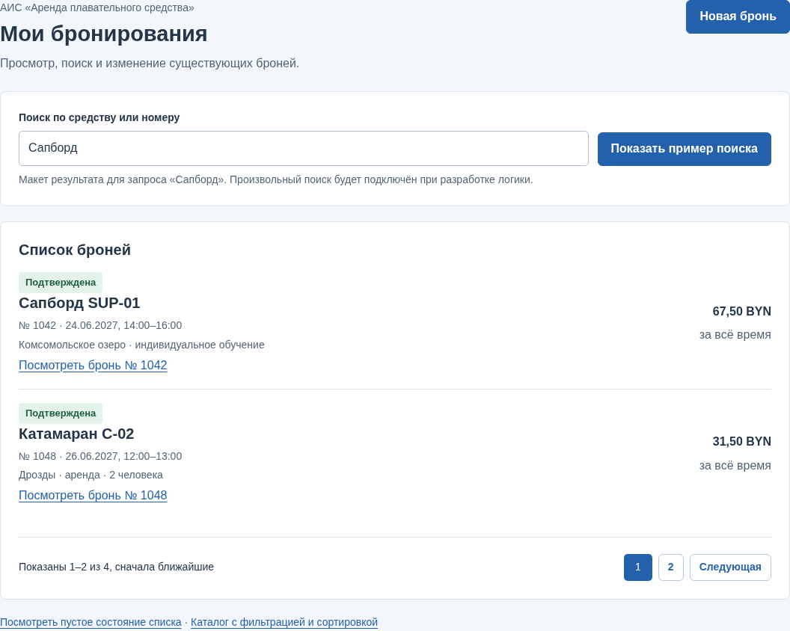
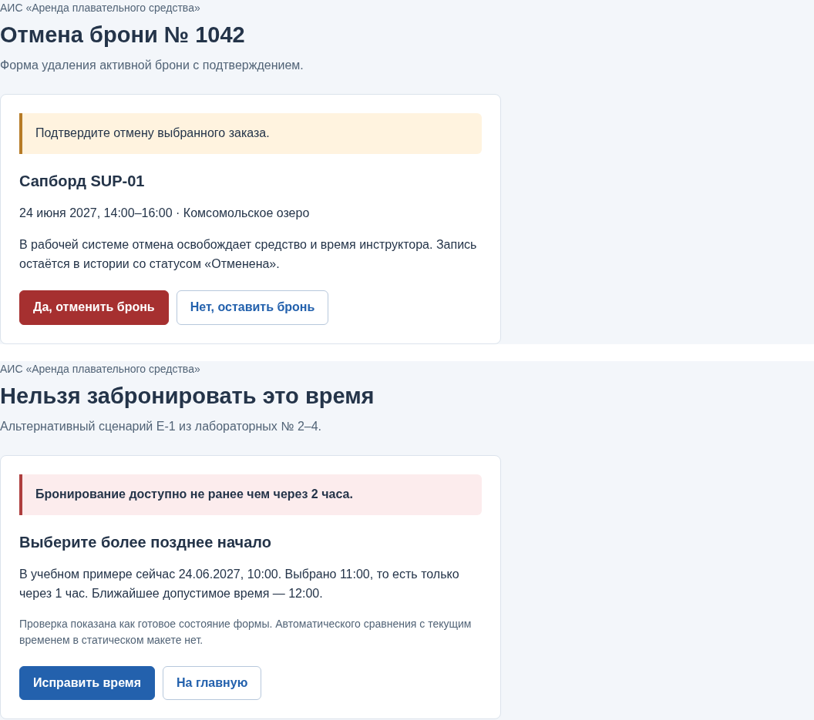
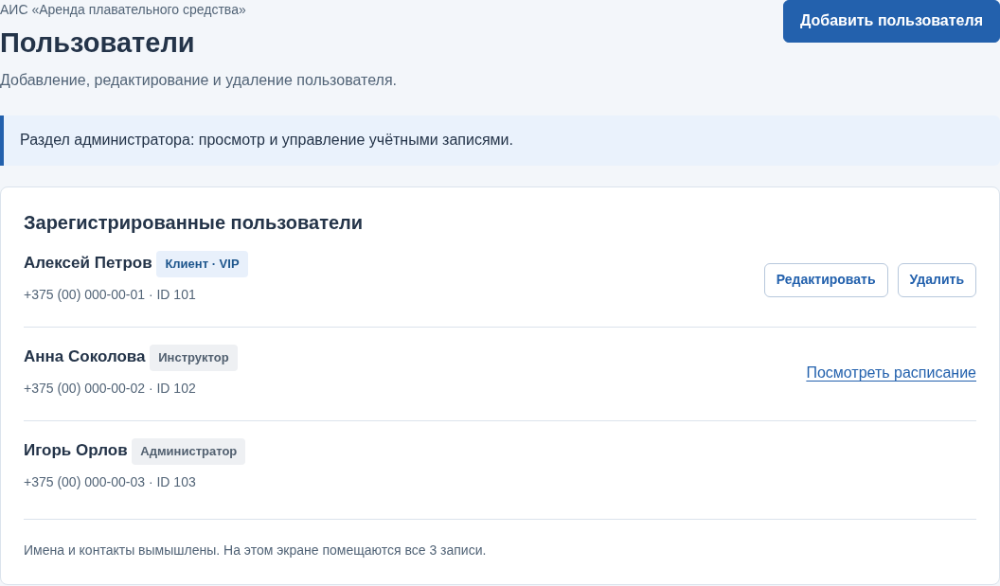

Белорусский государственный университет

Факультет прикладной математики и информатики

Кафедра технологий программирования

ОТЧЕТ

о выполнении лабораторной работы № 5

по дисциплине «Технологии программирования»

Проектирование веб-приложений.
Прототипирование интерфейса. HTML + CSS

АИС «Аренда плавательного средства»

Выполнил:

студент 3 курса, группы 8

Вдовин Дмитрий Евгеньевич

Минск, 2026

## 1. Цель работы

Познакомиться с принципом построения одностраничных приложений и разработать статический прототип интерфейса АИС «Аренда плавательного средства» с помощью HTML и CSS.

В качестве основы использованы предметная область и сценарий бронирования из лабораторных работ № 2–4. Текущая работа соответствует слою представления View: показывает, какие данные вводит пользователь и какие состояния должен отображать интерфейс.

## 2. Предметная область и требования

Предприятие предоставляет в аренду катера, лодки, катамараны, рафты и сапборды, проводит индивидуальные и групповые занятия на нескольких площадках. Клиент выбирает средство, площадку, дату, время, количество человек и дополнительные услуги. Администратор может оформить заказ по телефону; инструктор просматривает собственное расписание; руководитель получает отчёты.

Основное ограничение: бронирование начинается не ранее чем через 2 часа от текущего времени. Также предусмотрены VIP-скидки, оплата разового занятия, месяца или курса и заморозка абонемента.

По заданию требуются следующие элементы:

- главная форма, меню, header, footer и пустое состояние;

- формы добавления, редактирования, удаления, поиска и просмотра;

- экран ошибки, пояснения к действиям и связи между прототипами;

- сортировка, фильтрация и переход к дополнительным страницам списка;

- файлы UI/index.html и UI/styles.css, без сторонних библиотек и табличной вёрстки.

Дополнительно подготовлены формы входа и управления пользователями. Все имена, контакты, тарифы и значения показателей в макете являются учебными данными.

## 3. Проектирование интерфейса

Прототип содержит 32 экрана и состояния в одном HTML-файле. Общие header, меню и footer вынесены за пределы переключаемых разделов. В зависимости от якоря ссылки CSS показывает нужный раздел; при пустом или неизвестном якоре открывается главная.

Связь основного сценария: главная → форма бронирования → проверка и подтверждение → результат создания → карточка брони. Из карточки доступны редактирование и отмена с отдельным подтверждением. Ошибки возвращают пользователя к форме для исправления параметров.



*Рисунок 1. Низкодетальные прототипы основных экранов и переходы между ними.*

Схемы сохранены в docs/wireframes/screens.svg и roles.svg. В разделе «Карта экранов» размещены активные ссылки на состояния. На схемах стрелками показаны связи; на каждом макете обозначены общие верхняя и нижняя части страницы.

## 4. Главная форма и навигация

На главной расположены ближайшая бронь, остаток занятий по абонементу и VIP-статус. Основное действие — «Забронировать». Боковое меню открывает бронирование, список заказов, абонемент, расписание, отчёты и пользователей.



*Рисунок 2. Главная страница с общей навигацией, header и footer.*

Для нового клиента предусмотрен отдельный пустой список: сообщение «Бронирований пока нет» и ссылка на создание первой брони. Он доступен из карты экранов и из списка заказов.

На узком экране меню переносится в строки, а карточки и поля формы располагаются в одну колонку. Для клавиатурной навигации добавлены заметный фокус и ссылка перехода к основному содержимому.

## 5. Добавление и подтверждение брони

Форма содержит тип средства и услуги, площадку, дату, время, длительность, количество человек, способ оплаты и дополнительные услуги. Поля заказа по телефону вынесены в раскрываемый блок.



*Рисунок 3. Форма создания брони.*

На экране подтверждения показан фиксированный пример: сапборд на 2 часа — 40 BYN, инструктор — 30 BYN, жилет — 5 BYN. Скидка VIP 10% составляет 7,50 BYN, итог — 67,50 BYN. После подтверждения открывается результат создания брони № 1042.

## 6. Просмотр, поиск и редактирование

Список «Мои бронирования» разделён на две страницы по две записи. На первой показаны активные заказы, на второй — история. Каждая запись содержит статус, время, площадку, сумму и ссылку на собственную карточку.



*Рисунок 4. Список броней, поиск и переход на следующую страницу.*

Поиск показывает готовый пример результата для слова «Сапборд». Дополнительно подготовлено состояние «Ничего не найдено». В каталоге фильтрация по типу и сортировка по возрастанию или убыванию цены выполняются средствами CSS.

Редактирование открывается из карточки № 1042. Форма заполнена исходными данными; результат иллюстрирует перенос занятия с 14:00 на 16:00. Статический список после перехода к результату остаётся прежним.

## 7. Отмена и обработка ошибок

Перед отменой показываются номер и параметры заказа, а также два действия: подтвердить отмену или оставить бронь. Это позволяет отделить опасное действие от обычного просмотра записи.



*Рисунок 5. Подтверждение отмены и ошибка ограничения по времени.*

Для ошибки E-1 время примера зафиксировано: 24.06.2027, 10:00. Начало в 11:00 нарушает правило 2 часов; ближайшее допустимое начало — 12:00. Для ошибки E-2 показано сообщение о занятости средства или инструктора. В обоих случаях есть ссылка на исправление параметров.

## 8. Администратор и другие роли

В разделе «Пользователи» отображаются ФИО, телефон и роль. Подготовлены отдельные формы добавления и редактирования, подтверждение удаления и экраны результатов. Обязательные поля имеют подписи и встроенную HTML-проверку.



*Рисунок 6. Список пользователей в кабинете администратора.*

Экран инструктора содержит только собственные занятия. В разделе руководителя показаны часы аренды, часы работы инструкторов, часы занятий, посещаемость и минимум/максимум аренды по дням. Столбчатая диаграмма выполнена на CSS, значения также подписаны текстом.

Для клиента добавлен абонемент с остатком занятий и форма заморозки. Вход и переключение между ролями являются демонстрацией интерфейса; реальное разграничение прав на этом этапе не реализовано.

## 9. Реализация на HTML и CSS

Смысловые блоки размечены элементами header, nav, main, section, article, aside и footer. Ссылки используются для переходов, button — для отправки и сброса форм. label связан с полем через for/id, группы вариантов оформлены fieldset и legend. Для расположения блоков используются Grid и Flexbox; тег table не применяется.

Пример формы и связанного с ней экрана:

```
<form action="#review" method="get">
  <label for="new-people">Количество человек *</label>
  <input id="new-people" type="number"
         min="1" max="6" value="1" required>
  <button type="submit">Проверить доступность</button>
</form>
<section class="screen" id="review">
  <!-- Подготовленное состояние подтверждения -->
</section>
```

Переключение разделов без сторонних библиотек:

```
.screen { display: none; }
#home { display: block; }
main:has(> .screen:target:not(#home)) > #home {
  display: none;
}
main > .screen:target { display: block; }
```

Фильтр каталога реагирует на выбранную радиокнопку с помощью :has(), а порядок карточек меняется свойством order. Медиазапросы перестраивают страницу для планшета и телефона. Все стили хранятся в UI/styles.css; встроенных стилей и подключённых скриптов нет.

Это статический прототип в рамках концепции SPA, а не готовая информационная система. Ссылки переключают состояния внутри документа. Отправка нативной HTML-формы может перезагрузить тот же файл. Введённые данные не передаются в подготовленные результаты, а создание, изменение, удаление и проверка ресурсов пока не изменяют данные.

## 10. Проверка и исходные файлы

Проверка выполнена в Google Chrome 158.0.8127.36. Для каждого из 32 состояний проверены ширины 1440, 768, 390 и 320 пикселей — всего 128 сочетаний. На экране открывается один раздел с одним видимым h1, общими header и footer; горизонтального переполнения не обнаружено.

- Проверены все внутренние ссылки и адреса форм: целевые разделы существуют, повторяющихся id нет.

- Проверены подписи полей, CSS-фильтрация и сортировка каталога, переключение страниц и отклонение значения 0 для количества человек.

- Пройдены переходы создания, редактирования и отмены брони, добавления пользователя и входа.

- Проверен запуск непосредственно по file://; схема прототипов и фильтр каталога доступны без сервера.

- Ошибок выполнения в браузере и HTTP-ошибок подключаемых ресурсов не обнаружено.

Результаты проверки и снимки экранов сохранены в docs/testing.md и docs/screenshots. Проект не требует установки зависимостей: достаточно открыть UI/index.html в Google Chrome.

Репозиторий проекта: https://github.com/dmitry-udovin/tp-lab5-watercraft-ui

Репозиторий приватный. Для просмотра преподавателю необходимо предоставить доступ к его учётной записи GitHub либо передать локальную копию проекта.

## 11. Вывод

Разработан статический интерфейс АИС «Аренда плавательного средства». Подготовлены обязательные формы, состояния ошибок и пустого списка, схема переходов и дополнительные экраны для ролей системы. При выполнении работы использованы семантическая разметка HTML5, формы, Grid, Flexbox, медиазапросы и CSS-селекторы состояний. Следующий этап — подключение бизнес-логики и хранения данных к подготовленной вёрстке.

## 12. Использованные материалы

1. Задание «Лабораторная работа 5 (HTML, CSS)», 2026, пункты 1–8.

2. Отчёт по лабораторной работе № 2: описание предметной области и сценарий бронирования.

3. Отчёты по лабораторным работам № 3 и № 4: диаграмма деятельности, статическая модель и альтернативные сценарии E-1 и E-2.
